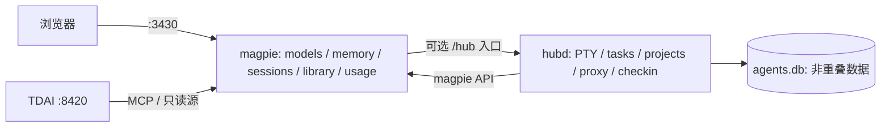
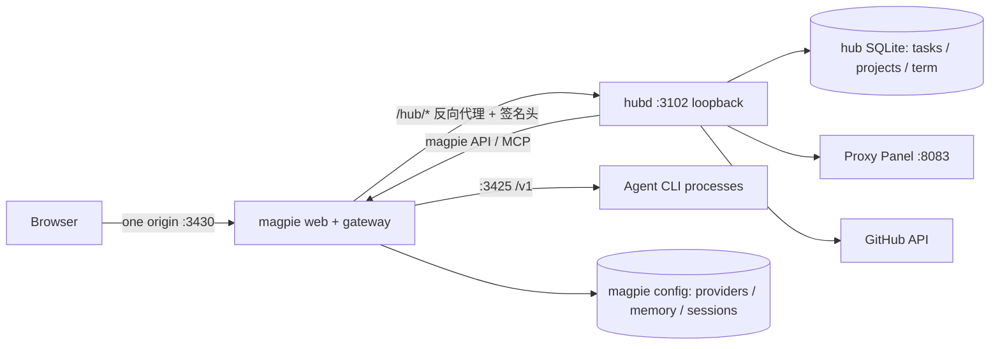

# magpie × AgentHub 融合实施方案

> 日期：2026-11-20
> **二次评估（2026-11-20 晚，用户裁定优先）**：重叠功能一律「取 magpie 的实现 + 迁 AgentHub 的数据」，不保留 AgentHub 的重复实现；magpie 只在重大功能/安全需要时升级，升级前备份 + 数据兼容测试。据此，第 0 节改写；第 3/4 节的独立进程桥降级为「只服务非重叠域」。
> 目标：magpie 作为唯一入口与模型控制面；AgentHub 的数据并入 magpie，剩余独有能力作为小服务保留。

---

## 0. 结论（二次评估后，先看这 5 条）

1. **重叠域不再“各留一份”。** 记忆、会话、技能、MCP、模型/用量这五块，magpie 的实现更完整；AgentHub 里对应代码只保留迁移脚本/只读档案，迁移完成后退役。
2. **真正要迁的数据比想象少。** AgentHub 主库的核心行约 700 条（6 记忆、200 会话、488 消息、18 技能资产、1 MCP、2 模型日志、1 用户）；大量体积是 `term_recordings`（702 MiB）、`profile_events`（20 万行）、`mcp_source_cache`（3.9 万行）等**非重叠**数据。
3. **“magpie 没数据”多数是开关/导入问题，不是缺数据。** 实测 magpie 会话读取默认全关（`magpie sessions read` 全是 `off`），而本机已有 Claude 193 个、OpenCode 161 个原生会话；技能在 `~/.agents/skills` 有 68 个，magpie Library 为 0；记忆真源在 TDAI（411 条 L1 / 13,227 条 L0），不在 AgentHub 的 6 行表。
4. **升级风险用“钉版本 + 原生格式 + 备份”控制，不必为升级放弃合并。** 合并后数据落在 magpie 自己的 Markdown/JSON/SQLite 格式里，上游升级负责自己的迁移；我方只在重大版本升级，升级前 `magpie backup` + 数据快照 + 兼容用例。
5. **AgentHub 只保留 magpie 没有的部分。** 终端 PTY、任务 DAG、本机/GitHub 项目、Proxy Panel、资源 kill、签到、数据集/经验库。它们作为一个小 hubd 服务（或后续 Go 模块）存在，与 magpie 通过稳定契约连接，不参与 magpie 的模型/记忆/会话升级。

> 一句话：**合并的是“功能与数据”，不是“把 Python 代码塞进 Go”。重叠域用 magpie 原生实现吸收数据；非重叠域留在小 hubd。**

---

## 0.1 数据实况（决定迁移成本的关键）

| 数据 | 实测量 | 归属裁定 |
|---|---:|---|
| AgentHub `memories` | 6（4 active + 2 deleted） | 导入 magpie Memory |
| AgentHub `memory_docs` | 1（L2；L3 为空） | 内容并入 magpie Memory/Instructions |
| TDAI L1 结构化记忆 | **411 行 JSONL**（API 计数 376；含 314 episodic / 66 instruction / 31 persona） | **不复制**：既有 magpie memory 明确 TDAI 为权威源，避免双份 token；保留 TDAI 外部访问 |
| TDAI L0 会话 | **13,229 行 / 8.9 MB**（API 计数 13,227） | **不导入**；保留 TDAI，作为外部 MCP 源 |
| TDAI L2/L3 | 7 场景 / 1 persona | L3 只取非敏感的环境事实进 Instructions；主机/凭据类留在 TDAI |
| AgentHub `chat_sessions` / `chat_messages` | 200 / 488 | 导出只读档案；新会话写 magpie session header |
| 本机原生会话 | Claude 193、OpenCode 161、Codex 0（当前） | 打开 magpie `sessions read` 即可见，不需迁移 |
| `~/.agents/skills` | 68 个技能目录 | `magpie library skill hand-over` 迁入 Library |
| AgentHub `skill_assets` | 18 条（全 draft，`path=null`） | 只作登记参考，不迁状态机 |
| AgentHub `mcp_servers` | 1（ekko-studio-use） | `magpie library mcp add` 迁入 |
| magpie Library MCP | 1（magpie-memory） | 保留；与 hub 的 1 条合并 |
| magpie 用量 | 2,304 行 CSV（7 天 2,274 调用） | magpie 为唯一账本；hub 的 2 条日志不迁 |
| AgentHub `agent_models` | **0** | 无数据可迁；magpie 是模型唯一写者 |
| AgentHub `custom_agents` | 14（全是扫描到的 service） | 不是 Agent；留 hub 服务清单或丢弃 |
| AgentHub `users` | 1（admin） | 映射到 magpie web key；hub 角色仅服务非重叠页 |
| AgentHub `checkin_machines` / `runs` | 2 / 51 | 与 magpie 的供应商签到**不是同一功能**，留 hub |
| AgentHub `tasks` / `task_runs` | 96 / 28 | magpie 无对应；留 hub |
| AgentHub `term_recordings` | 2,951,514 行 / 702 MiB | magpie 无终端；留 hub 并按保留期归档 |
| AgentHub `profile_events` | 200,830 | magpie 无运行态事件；留 hub/归档 |
| AgentHub `mcp_source_cache` | 38,890 | 派生缓存；不迁，重扫即可 |

**结论**：重叠域可迁数据不足 1,000 行 + TDAI 411 条 L1；其余大体积数据恰好都在“magpie 没有”的域里。迁移成本从“周”降到“天”。

---

## 0.2 为什么不再走“双实现 + 桥优先”

上一版把“独立升级”理解成“业务必须在独立进程”，代价是两套记忆/会话/技能长期并存。二次评估后改为：

- **重叠域**：magpie 原生实现 + 数据迁移；AgentHub 代码退役。升级风险由“钉版本 + 备份 + 原生格式”承担。
- **非重叠域**：小 hubd + 稳定契约；magpie 升级不碰它们。
- **桥**：只保留一个“Hub 页”入口，不再承载记忆/会话/技能/MCP 的业务代理。

这样既满足“取 magpie 功能、取 AgentHub 数据”，也避免“为了独立升级而长期养两套重复实现”。

---

## 0.3 升级策略（回应“不频繁升级即可规避”）

| 策略 | 做法 |
|---|---|
| 钉版本 | magpie 固定在已验证 tag；只在安全修复、必需 Provider/模型、季度窗口升级 |
| 关闭自动更新 | **当前实测：自动更新开，每 6h 检查并下载**（`magpie update auto`）。要钉版本必须先 `magpie update auto off`，否则“不频繁升级”不成立 |
| 通道 | 保持 `stable`；不用 `daily`；`noUpdatePill` 可按需隐藏提示 |
| 升级前 | `magpie backup --no-agents` + `~/.config/magpie/memory` 快照 + `library.json` 快照 + hub DB 快照 |
| 升级后 | 跑数据兼容用例：记忆 411+ 条可检索、会话数量、Library 技能/MCP、用量合计 |
| 回滚 | `magpie restore` + 目录回拷；hub 不受影响 |
| 数据格式 | 只写 magpie 支持的字段（kind/scope/tags/why/sources/pinned），不自造字段；上游迁移有责任 |
| 非重叠域 | hubd 独立发布；magpie 升级不重启 hubd |

> 这比“夜间追 main”更符合单机生产：**升级是事件，不是常态**。但“钉版本”不能替代备份与兼容用例。

---

## 0.4 修订后的目标形态



- 记忆/会话/技能/MCP/用量：**magpie 内完成闭环**。
- Hub 页只列非重叠模块；没有 Hub 也不影响 magpie 的记忆、会话、技能、模型。
- 升级 magpie 时，hubd 不需要动；升级 hubd 时，magpie 不需要动。

---

## 0.5 执行回执（2026-11-20 02:00–02:30）

| 项 | 结果 | 证据 |
|---|---|---|
| P0 备份 | `data/_archive/p0-20261120/{agents,catalog}.db` | sha256 `af9cc079…` / `52d83f83…`；`integrity_check=ok` |
| P0 配置快照 | magpie memory/library/settings + 二进制 | `data/_archive/p0-20261120/magpie/` |
| 自动更新 | 已关 | `magpie update auto` = off；`noAutoUpdate=true` |
| 记忆 | 5 条 hub 历史以 `archived` 导入；2 条 deleted 跳过 | `hub-mem-1..4`、`hub-l2`；active 记忆仍 4 条 |
| TDAI | **未复制** | 既有 magpie memory 明确「不要复制 TDAI，避免双份 token」；`tdai-*` 文件 0 |
| 会话 | `sessions read on all`；magpie 可见 **2,526** 条 | `/api/sessions` 实测 |
| 会话档案 | 200 会话 / 488 消息 | `data/_archive/hub-chat-20261120.jsonl` 1.4 MB |
| 技能 | 68 个导入 Library | `library.json .skills|length=68`；`~/.agents/skills` 改为指向 library |
| MCP | `ekko-studio-use` 迁入 | `library.json .mcp|length=2`，`local=true`，agents=hermes |
| LLM 路径 | 修 `/v1/v1/messages` 404 | `messages_url()`；实际 `POST /v1/messages` 200 |
| 前端 | 新增 magpie 统一页，撤下记忆/技能/MCP/模型计量旧入口 | `#page-magpie` + `18-magpie-unified.js`；前端用例 42 绿 |
| 重复索引 | memindex / memvitals timer 已停 | `systemctl --user is-enabled` = disabled |
| 待重启 | agenthub 有 1 个活终端，未强杀 | 新 `/api/magpie/ui` 需重启后生效 |

**未完成/需后续**：
- P2 的后端重复路由（`/api/memory/*`、`/api/skill/*`、`/api/mcp/*`）仍保留兼容，尚未改成 410/薄委托；前端已不再走它们。
- P3 的终端录像 702 MiB 归档未执行（需维护窗口）。
- P4 的 magpie 侧桥未做；按用户 2026-11-20 追加重定义，改为 **AgentHub 前端映射 magpie**，不修改 magpie 代码。前端已实现，待重启验证。

---

## 1. 取证基线

### 1.1 两个系统的规模与运行形态

| 维度 | magpie | AgentHub |
|---|---|---|
| 语言/框架 | Go 1.26.8，单二进制 + Wails GUI + TUI + Web | Python 3.11 / FastAPI / uvicorn |
| 代码规模 | 1,391,897 行 Go（含测试），6,761 个 `.go`（`internal` 6,703） | 54,435 行 `src/*.py`，129 个顶层 Python 模块（另含 `adapters/`、`catalog/` 子包），449 个测试文件 |
| 路由面 | 网关协议 + 管理 API + MCP servers + 插件页 | 219 条 FastAPI 路由 |
| 端口 | 网关 `:3425`，Web `:3430` | Web `:3102`，注入代理 `:3103`，桥 `:3200+` |
| 数据 | 配置/记忆为 Markdown/JSON；会话读 Agent 原生文件 | SQLite：`agents.db` 968 MiB、`catalog.db` 1.7 GiB、`memindex.db` 5.78 GiB |
| 当前关系 | 被 AgentHub 作为模型网关使用 | 已接 magpie：`.env:10`、`.env:28`；magpie web `:3430` 供 hub 嵌入（`magpie.service` 注释） |

### 1.2 magpie 已经覆盖、AgentHub 仍在重复的域

| 域 | magpie 证据 | AgentHub 重复模块 |
|---|---|---|
| 模型/Provider/路由/额度 | `internal/provider`、`internal/gateway`、`/v1/models` 实测 52 个模型 | `src/modelcfg.py`、`modelcfg_writers.py`、`api_models.py`、`gwprobe.py` |
| 用量/请求账本 | `/v1/magpie/usage`、`/v1/magpie/usage/requests`、`internal/usage` | `src/modelcalls.py`、`src/ledgernorm.py` |
| Agents 配置/模型写入 | `internal/agent`（60+ Agent）、Agents 页面 | `src/profiles.py` 的模型段、`capabilities.py` 的模型设置段 |
| 会话读取 | `internal/sessions`（原生转录 + 网关投影） | `src/sessions_store.py`、`api_sessions.py` |
| 记忆 | `internal/memory`（Markdown 真源、MCP、语义检索、digest） | `src/memory.py`、`memfed.py`、`memindex.py`、`memvitals.py`、`kb.py` |
| 技能路由/库 | `internal/library`（skills、skill router、MCP router、instructions） | `src/skill.py`、`skill_store.py`、`skill_direct.py`、`skill_assets.py` |
| MCP 聚合 | `internal/library/mcp_hub.go`、`/mcp/magpie/hub/<agent>`（`hub_mcp.go:33`） | `src/mcpgw.py`、`mcpregistry.py` |
| 鉴权/密钥 | `internal/access`（命名 key、限额、OIDC、join） | `src/users.py`、`authz.py`（用户/角色层） |

### 1.3 AgentHub 独有、magpie 没有的域

| 域 | 代码/数据 | 说明 |
|---|---|---|
| 终端 PTY | `src/term.py` 1,703 行 + `static/hub/04-terminal-ws.js` | WebSocket + xterm.js；magpie 只调用外部终端，无内置 PTY |
| 任务编排 | `tasks.py` 875、`tasks_runner.py` 994、`tasks_dag.py` 584、`tasks_tiers.py` 617 | 声明式 DAG、验收三态、派发权重 |
| 本机项目 | `src/localprojects.py` 604 | 多根 `.git` 扫描、worktree/垃圾目录剪枝、分档 |
| GitHub 项目 | `src/githubprojects.py` 818 | 远端仓库分页、严格 remote URL 匹配、浅克隆 |
| Proxy Panel | 外部 `~/proxy-panel/server.py` 1,613 行，`:8083` | xray 订阅/测速/节点池/双线切换；magpie 只有按账号出站代理 |
| 资源与进程 | `src/resources.py`、`vitals.py` 899 | 本机 Agent 进程 CPU/内存 + 受控 kill |
| 签到/数据集/经验库 | `checkinmgr.py` 748、`dataset.py`、`api_dataset.py` | 本机业务，不属于模型网关 |
| 用户/角色 | `users.py` 569、`user_perms` | magpie 只有 key/OIDC，无页面级角色 |

### 1.4 当前前端使用证据（来自 `docs/AGENTHUB-ITERATION-PLAN-20261120.md`）

- 21 天内：协同 tasks 9,745 次；MCP 浏览 9,423 次但安装/运行/同步 0 次；定时 jobs 9,403 次轮询但新建/改/运行 0 次。
- 遥测 0 次、Botboy 1 次、资源 9 次、端口 3 次；遥测/资产/Botboy 三页已于 2026-11-20 删除。
- 结论：**融合不是把所有页面搬过去，而是把仍在用的入口收进一个壳，把 0 调用的页面留在原服务或冻结。**

---

## 2. 能力对比与模块裁定

### 2.1 逐域裁定

| 域 | 融合后归属 | 裁定 | 理由 |
|---|---|---|---|
| Agent 身份/模型/配置 | magpie | **并入 magpie 原生** | magpie 已有 60+ 适配器与原子写配置；AgentHub 的 `agent_models` 实测 0 行，重复无收益 |
| Agent 运行态/拉起/UI 入口 | hubd | **留在 hubd，经桥暴露** | 依赖 `/proc`、systemd、docker、PTY、注入代理；magpie 是跨平台网关，不应内置 NAS 进程管理 |
| 模型设置/计量 | magpie | **退役 hub 重复实现** | magpie `/v1/magpie/usage` 是唯一账本；hub 再记一份必然漂移 |
| 会话读取 | magpie | **magpie 为唯一读取面** | `internal/sessions` 已读原生转录；本机 Claude 193 + OpenCode 161 条，只需打开 `sessions read`；hub 的 200 会话/488 消息转只读档案 |
| 记忆 | magpie 真源 + TDAI 作为外部源 | **迁 6 条 + TDAI L1 411 条；L0 不迁** | magpie Markdown 真源、MCP、语义检索已完整；TDAI L0 13,227 条是会话库，不是短记忆，复制会造第二索引 |
| 知识库/文档检索 | hubd | **保留（magpie 无本地文档索引）** | `kb.py` 是 TDAI + turbovec + 本地记忆的联邦门面；magpie 的 search 是网页搜索，不覆盖 `/fs/1000/ftp/技术文档` 的 2,791 chunks |
| 技能 | magpie Library | **68 个技能迁入，退役 hub 存储** | magpie 已有 skill router、按 Agent 勾选、Claude/Codex/Pi/Droid stub；`hand-over` 是现成迁移命令 |
| MCP | magpie Library | **迁移 1 个 server，退役 hub 运行器** | magpie hub MCP 已能按 Agent/项目聚合；hub 只保留自己的动作 MCP |
| 终端 | hubd | **保留，二期再评估 Go 重写** | PTY + WebSocket + xterm 是独立子系统，移植风险最高 |
| 任务 DAG | hubd | **保留** | magpie 无对应能力；先经 `/hub/v1` 暴露给 magpie 页面 |
| 本机/GitHub 项目 | hubd | **保留并做成 Hub 页** | 文件系统扫描与 clone 是 hub 的强项；magpie 的 Project 只服务 MCP 作用域 |
| Proxy Panel | 外部服务 + hub 桥 | **不并入网关，做统一入口** | xray 订阅/切换不是模型网关职责；重写 1,613 行 Python 收益低 |
| 用户/角色 | hubd 保留，magpie 做入口认证 | **桥 SSO + 角色映射** | 不把两套账号体系硬合并；magpie key 管 API，hub 角色管页面动作 |
| 资源/端口/签到/数据集 | hubd | **保留；低使用页面冻结** | 本机运维与业务数据，与网关无关 |

### 2.2 退役清单（按可删除行数排序）

| 模块 | 行数（约） | 处置 | 验收 |
|---|---:|---|---|
| `modelcfg.py` + `modelcfg_writers.py` + `api_models.py` + `gwprobe.py` | 3,500 | 改为读 magpie `/v1/models`、写经 magpie CLI/API | 模型清单逐项一致；hub 不再写 Agent 配置 |
| `skill.py` + `skill_store.py` + `skill_direct.py` + `skill_assets.py` | 4,400 | 技能迁 magpie Library；hub 只留调用遥测 | 技能数/勾选/路由一致；`Skill` 调用可计数 |
| `memory.py` + `memfed.py` + `memindex.py` + `memvitals.py` | 3,400 | 真源迁 magpie；TDAI L0 注册为外部源 | 20 条查询结果对照；无双写 |
| `kb.py`（**不退役**） | 537 | 保留为文档检索门面；只把 L1 记忆那一路改为 magpie | 文档检索命中不退化；四路表态仍完整 |
| `mcpgw.py` + `mcpregistry.py` | 1,600 | 迁 magpie Library；hub 只留 hub 动作 MCP | server 清单一致；工具调用走 magpie hub |
| `sessions_store.py` + `api_sessions.py` | 1,500 | 只读档案 + 新会话写 magpie session header | 会话列表一致；导出可回放 |
| 合计 | **≈14,400** | | hub 从 54k 降到 ≈40k |

> 行数为文件级估算，不代表可全部物理删除；部分模块需保留薄适配层（预计 1,500–2,000 行）。

### 2.3 合并后的 Agents 页面（最终形态）

magpie 的 Agents 行保留原有「模型选择 + 配置写入 + 连接/断开」，新增一块 **Runtime 条**，数据只来自 `/hub/v1/agents`：

| 字段 | 来源 | 交互 |
|---|---|---|
| `state`（running/installed/stopped） | hubd `/proc` + systemd + docker | 只读徽标 |
| `pid` / `port` / `ui` | hubd 探测 | 只读 |
| 入口 | hubd | `终端`（`/hub/term?agent=…`）、`原生界面`（`/hub/embed/…`）、`对话`（magpie `/v1`） |
| 资源 | hubd `/hub/v1/resources` | CPU/内存；kill 需二次确认，仅限 Agent |
| 模型 | magpie | 唯一写者；hub 不再提供模型下拉 |

关键约束：**Agents 的身份/模型由 magpie 定义，运行态由 hubd 定义**。两边用同一个 `agent id` 对齐；Agents 页面不合并两套配置，只合并两套视图。

| AgentHub 卡片字段 | 合并后位置 | 处置 |
|---|---|---|
| 名称/图标/描述 | magpie Agents 行 | 保留；hub 提供 `desc` 供 Runtime 条 |
| 模型/口味/effort | magpie 模型选择器 | 唯一入口；hub 不再写 |
| 终端/原生会话/↗UI/对话 | Runtime 条按钮 | 指向 `/hub/...`；对话走 magpie 网关 |
| 启动/停止/重启 | Runtime 条 | 调 hubd 动作端点，写审计 |
| 服务类卡片（Proxy Panel、TDAI、gotty） | Hub 分组「服务」 | 不混入 Agents 列表，避免 magpie 把服务当 Agent |

### 2.4 项目与 Proxy Panel 的最终形态

- **本机项目**：Hub 页「本机项目」保留现有扫描/分档（`localprojects.py`），新增「新建会话」→ hubd 拉起终端；magpie 只负责导航与登录。
- **GitHub 项目**：同一页签的远端半程（`githubprojects.py`）；克隆仍由 hubd 执行，token 不经过 magpie。
- **Proxy Panel**：Hub 分组下的「代理面板」，复用 `embed_proxy.py` 的 Basic 注入；magpie 只透传页面，不接触 xray 口令与订阅 URL。
- **不合并数据**：项目清单、代理节点、签到记录都留在 hubd，避免把 NAS 运维数据写进 magpie 配置。

---

## 3. 目标架构（桥只服务非重叠域）

> 注意：本节及 3.1–3.4 的 `/hub/v1`、反代、SSO 只适用于 P3 之后的非重叠模块（终端/任务/项目/代理/签到/数据集）。记忆、会话、技能、MCP、模型/用量已在 magpie 内闭环，不再经过桥。



### 3.1 边界不变量

1. **单向依赖**：hubd 可以调 magpie；magpie 只通过 `/hub/v1` 调 hubd，绝不 import hub 代码、绝不读 hub DB。
2. **单写者**：每个业务域只有一个写者。magpie 写模型/Provider/记忆/会话索引；hubd 写任务/项目/终端/签到。
3. **无共享文件**：两进程不共享可写配置；共享只读密钥文件也仅限桥密钥。
4. **可降级**：hubd 挂了，magpie 网关与模型页面照常；magpie 挂了，hubd 页面照常（除需要 LLM 的功能）。
5. **契约优先**：桥只认 `/hub/v1` 的 JSON envelope 与模块清单，不认页面 DOM。

### 3.2 桥的职责（全部）

| 职责 | 说明 | 禁止 |
|---|---|---|
| 反向代理 | `GET/WS /hub/{path...}` → `HUB_UPSTREAM`，支持 SSE 与 WebSocket Upgrade | 不改写业务 JSON |
| 认证 | magpie 会话通过后注入 `X-Hub-Bridge: 1` + `X-Hub-User` + HMAC 签名 | 不把 magpie web key 传给 hub |
| 导航 | 从 `/hub/v1/meta.modules` 渲染 Hub 分组；hub 不在线时保留入口并显示离线页 | 不在 magpie 代码里硬编码 hub 页面清单 |
| 诊断 | `/hub/_health` 显示 hub 版本、契约版本、模块状态 | 不把 hub 日志写进 magpie 日志 |

签名方案：`HMAC-SHA256(secret, method + "\n" + path + "\n" + timestamp + "\n" + user)`，`X-Hub-Bridge-Sig`；hubd 校验时间窗 ±60s，拒绝无签名/错签名/非 loopback。密钥文件 `0600`，两服务只读，轮换时双密钥并存 24h。

命名注意：magpie 已有 `HubMCP`（`/mcp/magpie/hub/<agent>`，MCP 聚合），与本方案的 AgentHub 不是一回事。桥包固定叫 `internal/hubbridge`，页面叫「Hub」，避免与 MCP hub 混淆。

### 3.3 `/hub/v1` 契约（P1 必须冻结）

| 方法 | 路径 | 返回 |
|---|---|---|
| GET | `/hub/v1/meta` | `{api:"1", version, minBridge:"1.0", modules:[{id,label,path,icon,mode,minBridge}]}` |
| GET | `/hub/v1/health` | `{status, checks:{db,term,proxy,github}}` |
| GET | `/hub/v1/agents` | 运行态：`{id,name,state,pid,port,ui,capabilities}` |
| POST | `/hub/v1/agents/{id}/actions/{open\|stop\|restart}` | 动作结果 + 审计 id |
| GET | `/hub/v1/projects?tier=main` | 本机项目清档 |
| POST | `/hub/v1/projects/refresh` | 触发扫描（幂等） |
| GET | `/hub/v1/github/repos` | 远端仓库 + 本地匹配 |
| POST | `/hub/v1/github/clone` | `{slug}` → 克隆结果 |
| GET | `/hub/v1/resources` | Agent 进程资源 |
| GET | `/hub/v1/tasks` | 任务/运行摘要 |
| GET | `/hub/v1/proxy/panel` | 面板地址与登录方式（不返回口令） |

统一响应：`{ok, data, error:{code,message}, meta:{api,version,ts}}`。写操作支持 `Idempotency-Key`。v1 只做加法；破坏性变更开 `/hub/v2` 并行。

### 3.4 子路径挂载（P1 的真实难点）

AgentHub 现在大量使用根绝对路径：`/static/...`、`/api/...`、`/ws/...`。直接在 `/hub/` 反代会让这些请求打到 magpie。P1 必须先做 **BASE_PATH**：

1. hub 读 `HUB_BASE_PATH`（默认空；桥部署设为 `/hub`），模板用 `{{ base }}` 前缀 12 处静态链接。
2. 前端集中点加前缀：`api()`（`static/hub/01-core-boot.js:358`）、`wsUrl()`（`03-agents-cards.js:1312`）、`EventSource` 构造、少量直接 `fetch('/api/...')`。
3. Cookie `Path=/hub`；重定向统一 `Location: /hub/...`；`X-Forwarded-Prefix` 兜底。
4. 桥剥前缀：`/hub/api/*` → hub `/api/*`，`/hub/ws/*` → hub `/ws/*`，`/hub/static/*` → hub `/static/*`。
5. 验收：浏览器 Network 面板 0 个请求落到 magpie 的 `/api/*`；刷新/深链/终端 WS 全部正常。

若 BASE_PATH 改造超预算，**回退方案**是独立 origin（`http://127.0.0.1:3102/hub-entry?t=<签名 token>`）+ iframe；导航仍在 magpie，但放弃「同源单 cookie」。这是兜底，不作为主线。

---

## 4. 独立升级机制（本方案的核心）

### 4.1 版本与仓库

| 产物 | 版本线 | 升级节奏 | 依赖 |
|---|---|---|---|
| magpie 上游 | `0.1.x` | **钉已验证 tag；安全/必需功能/季度窗口才升** | 无 hub 依赖 |
| hubd | `0.14.x` 起 | 本仓节奏 | 只依赖 `/hub/v1` 契约与 magpie 公共 API |
| magpie-hub 桥 | `1.0.x` | 与契约同版 | 只依赖 magpie 的 mux/plugin 公共面 |
| 契约 | `hub-api/1` | 年度大版本 | 双端各自实现 |

### 4.2 升级纪律（钉版本，不做夜间追 main）

- **不追 main。** magpie 固定在已验证 tag；只在安全修复、必需 Provider/模型、季度窗口升级。
- 桥补丁只落 3 个位置：`internal/hubbridge/`、`internal/gui/api.go` 一行挂载、导航入口；目标 diff ≤500 行。
- 只在升级候选版本上 rebase 桥分支并跑契约测试，不做每周 rebase；`git rerere` 记录冲突解。
- 升级失败：桥编译失败被升级闸门拦住；`HUB_BRIDGE=0` 保留入口降级，hubd 仍独立运行。
- 数据兼容优先于桥：升级前跑 `tests/migrate/test_parity.py`，确认记忆/会话/技能/MCP/用量仍可读。

### 4.3 升级闸门与契约测试

| 测试 | 位置 | 断言 |
|---|---|---|
| 升级前备份 | 脚本 | `magpie backup` + memory/library/settings + hub DB 快照，hash 记录 |
| 数据兼容 | `tests/migrate/test_parity.py` | 417 条记忆可检索；≥354 原生会话；68 技能；2 MCP；用量合计 |
| 契约 fixture | `tests/contract/fixtures/*.json` | `/hub/v1` 字段、枚举、错误码不漂移 |
| hub 端 | `tests/contract/test_hub_v1.py` | 端点 schema、幂等、鉴权拒绝 |
| 桥端 | `internal/hubbridge/contract_test.go` | 反代不改 body、WS 升级、签名头、超时 |
| 故障注入 | `tests/contract/test_degrade.py` | hub 停/超时/500 时 magpie 页面可解释降级 |
| 升级候选 | 人工触发，非 nightly | 最近 1 个稳定 tag + 目标 tag；通过才升级 |

### 4.4 部署与回滚

- systemd：`agenthub.service`（现有）+ `magpie.service`（现有）。桥在 magpie 进程内。
- 启动顺序无强依赖：magpie 先起也能工作；hub 后起，桥在 60s 内重试探测。
- 回滚三档：
  1. `HUB_BRIDGE=0` + 重启 magpie → 入口消失，hub 仍在 `:3102`；
  2. 回滚 hubd 到上一个 tag → magpie 不需重启；
  3. 回滚桥包到上一个 tag → 只影响入口。

---

## 5. 数据主权与迁移

### 5.1 数据归属

| 数据 | 唯一写者 | 存储 | 迁移动作 |
|---|---|---|---|
| Provider/模型/路由/额度 | magpie | `~/.config/magpie/*.json` | 不迁；hub 停写 |
| Agent 配置 | magpie | 各 Agent 原生配置 | 不迁；hub 停写 |
| 记忆 | magpie | `~/.config/magpie/memory/*.md` | 6 条 `memories` + 1 `memory_docs` + TDAI L1 411 条导入；TDAI L0 不迁 |
| 技能 | magpie | Library skills 目录 | `hand-over` 迁 68 个技能 + 勾选关系；18 条 draft 只作参考 |
| MCP server | magpie | `library.json` | 1 行 `mcp_servers` 手工/脚本迁移 |
| 聊天/会话 | magpie（读取面）+ hubd（终端录像） | Agent 原生文件 + hub `chat_*` 档案 | 200/488 行导出 JSONL；新会话带 `X-Magpie-Session` |
| 任务/项目/签到/数据集 | hubd | `agents.db` | 不迁；保持单写 |
| 终端录像 | hubd | `term_recordings` | 不迁；按保留期归档/降容 |

### 5.2 记忆迁移脚本（伪代码）

```python
# scripts/migrate/memory_to_magpie.py
# 1) 源 A：agents.db 的 memories(6) + memory_docs(1)
#    源 B：/vol1/tdai-data/records/*.jsonl（411 行：314 episodic / 66 instruction / 31 persona）
#         —— 直接读 JSONL，不依赖 TDAI 的搜索分页（其 API 无 list/export 路由）
# 2) 映射：
#    TDAI instruction -> rule/preference（why 保留原文）
#    TDAI episodic    -> episode；priority>=80 active，<80 candidate
#    TDAI persona     -> profile（长的进 Instructions）
#    hub decision/constraint -> rule；preference -> preference；fact -> fact
#    hub L2 文档 -> procedure/episode 长文（或 Instructions）
#    tags 带 ["tdai","imported", "priority-<n>"]，便于日后按来源筛选/回滚
# 3) 写 ~/.config/magpie/memory/<id>.md，front matter:
#    kind, scope: global, origin: imported, created, updated, tags, sources
#    只写 magpie 支持的字段，不自造字段；text 最长 2000 字符（TDAI 实测 1909）
# 4) --dry-run 输出每条映射与 20 条查询差异；--apply 前做目录快照
# 5) 幂等：内容 sha256 去重；同 id 已存在则跳过；导入前跑凭据正则扫描
```

验收：417 条（6+411）可检索；20 条查询中 18 条命中原文；`/api/memory/search` 改为调用 magpie MCP 返回同一条目；TDAI L0 不入库。

### 5.3 会话迁移

- 不把 hub 的 `chat_messages` 灌进 magpie 的会话文件格式（两者语义不同，强灌会制造伪会话）。
- 导出 `data/_archive/hub-chat-20261120.jsonl`（200 会话 / 488 消息），提供只读下载；hub 页面标注「历史档案」。
- 新链路：hub 调 magpie `/v1` 时带 `X-Magpie-Session: hub:<sid>`，magpie Sessions 直接可见；这是零迁移的长期方案。

---

## 6. 分期实施（数据优先）

### 6.1 总表

| 期 | 内容 | 工时 | 风险 | 回滚 |
|---|---|---|---|---|
| P0 | 备份、数据盘点、迁移脚本骨架 | 0.5–1 天 | 无 | 备份回拷 |
| P1 | 重叠域取 magpie 实现 + 迁数据（记忆/会话/技能/MCP/模型用量） | 3–5 天 | 中 | 逐域开关 + DB/目录快照 |
| P2 | 退役 AgentHub 重复代码，hub 只留薄委托 | 2–4 天 | 低 | 旧端点保留一版 |
| P3 | 非重叠域收口为小 hubd（终端/任务/项目/代理/签到/数据集） | 1–2 周 | 中 | 模块开关 + 旧版本 |
| P4 | 单入口（magpie 外壳 + Hub 页）与升级加固 | 3–5 天 | 中 | `HUB_BRIDGE=0` |
| P5 | 可选 Go 重写（资源→项目→画像→PTY→任务） | 3–6 周/模块 | 高 | 旧 Python 保留一版 |

> 关键变化：P1 不再先做桥，而是先把重叠域的数据迁进 magpie；这样即使入口还没统一，magpie 已经“有数据”。

### 6.2 P0：基线与迁移脚本骨架（今天可做）

1. 备份：`sqlite3 data/agents.db ".backup data/_archive/agents-20261120.db"`，同法 `catalog.db`；记录 sha256 + `integrity_check`。
2. 快照：`~/.config/magpie/memory`、`library.json`、`settings.json` 复制到 `data/_archive/magpie-20261120/`。
3. 关闭自动更新：`magpie update auto off`（当前实测每 6h 自动下载；不关就无法钉版本）。
4. 盘点：把第 0.1 节的表落成 `scripts/migrate/manifest.json`（每项的源、目标、条数、hash）。
5. 骨架：`scripts/migrate/` 下四个脚本 `memory.py`、`sessions.py`、`skills.py`、`mcp.py`，全部支持 `--dry-run`。
6. 兼容用例：20 条记忆查询、会话数量、技能/MCP 清单、用量合计，写成 `tests/migrate/test_parity.py`。

**验收**：备份可恢复；`--dry-run` 输出条数与第 0.1 节一致。

### 6.3 P1：重叠域迁数据（3–5 天）

| 域 | 动作 | 验收 |
|---|---|---|
| 记忆 | AgentHub 5 条（4 active + 1 L2）→ `~/.config/magpie/memory/*.md`，全部 `archived`；TDAI **不复制**（既有裁定：TDAI 权威、避免双份 token） | 5 条可查；active 仍 4；TDAI 检索走原服务 |
| 会话 | `magpie sessions read on all`（用户确认隐私后）；hub 200 会话/488 消息导出 `data/_archive/hub-chat-20261120.jsonl`；hub 新请求带 `X-Magpie-Session` | magpie 显示 **2,526** 条原生会话；hub 档案可下载；新会话在 magpie 可见 |
| 技能 | 不用 `hand-over`（对 symlink 源会留半成品）；改 `POST /api/library/skills/import-all`，68 个；18 条 `skill_assets` 只作登记参考 | Library 技能数 **68**；`~/.agents/skills` 指向 library |
| MCP | `magpie library mcp add ekko-studio-use <command…> agents=hermes --local`；保留 magpie-memory | Library MCP **2** 条；`magpie tools` 能看到工具 |
| 模型/用量 | 前端撤下「模型计量」旧入口，改由 magpie Usage；hub 旧路由保留一版 | hub 不再从导航写/画重复计量 |

补充：TDAI L0 13,227 条**不导入**。它是会话/情景库，不是 magpie 的短记忆；保留 TDAI 作为外部源（MCP 或只读 API），避免制造第二份会话索引。

### 6.4 P2：退役重复代码（2–4 天）

1. `memory.py`/`memfed.py`/`memindex.py`/`memvitals.py` → 只留 `/api/memory/*` 薄委托（调 magpie MCP）或直接 410 + 前端跳转。
2. `skill*.py` → 只留调用遥测；技能清单/安装/路由交给 magpie Library。
3. `mcpgw.py`/`mcpregistry.py` → 停用运行器；hub 只保留自己的动作 MCP。
4. `sessions_store.py`/`api_sessions.py` → 只读档案 + 导出；新会话走 magpie。
5. `modelcfg*`/`api_models`/`modelcalls` → 读 magpie，不再本地落库。

**验收**：代码扫描 0 处写 magpie 配置；0 处重建记忆/会话索引；hub `src` 行数下降 ≥1.2 万。

### 6.5 P3：非重叠域收口（1–2 周）

1. 保留：`term.py`、`tasks*`、`localprojects.py`、`githubprojects.py`、`resources.py`、`checkinmgr.py`、`dataset.py`。
2. 冻结/删除：遥测页已删；`custom_agents` 的扫描服务若无调用则停写；`mcp_source_cache` 只读归档。
3. 统一 `/hub/v1` 只服务这些模块；不代理记忆/会话/技能/MCP。
4. 资源：`term_recordings` 702 MiB 按 30 天归档；`profile_events` 保留期已有，维持。
5. 验收：hub 页面只列 8–10 个非重叠入口；`agents.db` 从 968 MiB 降到 <300 MiB（录像归档后）。

### 6.6 P4：AgentHub 前端映射 magpie（3–5 天，已实现首版）

> 2026-11-20 用户追加重定义：不改 magpie 代码；**把 AgentHub 前端改写为直接映射/调用 magpie**。桥方案降级为可选。

1. `GET /api/magpie/ui?view=…`：只给回环/已登录用户返回带 `MAGPIE_WEB_KEY` 的 URL；LAN 用请求 Host 重写。
2. 新页 `#page-magpie`：记忆 / 会话 / 技能 / MCP / 用量五个 tab，iframe 打开 magpie 原生页；不再本地重画。
3. 旧入口撤下：`SYS_PAGES` 去 `memory/skills/mcp`，`SET_PAGES` 去 `settings-modelcalls`；旧页面/端点保留一版兼容。
4. 升级闸门：`magpie update auto off` + `magpie backup` + `tests/test_migration_parity.py` + 回滚。
5. 验收：一个 hub 登录；切 tab 不重复登录；magpie 停时页面说清不可用；旧页面不再产生写。

**待办**：agenthub 重启后才能加载新 `/api/magpie/ui`；当前有活终端，未强杀。

### 6.7 P5：可选 Go 重写（按模块独立发布）

| 顺序 | 模块 | 原因 |
|---|---|---|
| 1 | 资源/端口 | 只读、接口小 |
| 2 | 项目扫描 | 纯文件系统、可测 |
| 3 | 画像/发现 | `/proc` + systemd + docker |
| 4 | PTY 终端 | 最难，WS + 终端语义 |
| 5 | 任务 DAG | 状态机复杂，或永久留 hubd |

**原则**：每迁一个模块，旧 Python 保留一版；`/hub/v1` 契约不变；magpie 不感知实现语言。

#### P5 评估：Go 重写是否有收益

**结论：现在不做全量 Go 重写；只有在“运行时足迹/单二进制部署”成为瓶颈时，才对只读模块做选择性 Go。**

| 维度 | Go 重写的收益 | 现实约束 |
|---|---|---|
| 部署 | 单静态二进制，无 venv/依赖漂移 | 当前 venv 已锁定；magpie 已提供 systemd |
| 内存 | 去掉 Python 解释器与 GIL，协程更轻 | cgroup 3.7 GiB 主要是 page cache + SQLite 读放大；先量再决定 |
| 并发 | PTY/WS/扫描并发更稳 | Python `asyncio` 当前未见瓶颈；终端问题多在协议细节 |
| 与 magpie 集成 | 可共享 Go 库/进程 | 同进程会破坏“独立升级”；独立二进制则不共享内存 |
| 升级隔离 | 独立二进制仍可独立发布 | 同仓 in-tree 合并会与 magpie 升级耦合 |
| 开发成本 | 长期维护少一套 Python | 14k 行 + 449 测试；Go 工具链当前未安装 |

**模块取舍**：

| 模块 | 建议 | 理由 |
|---|---|---|
| 资源/端口 | **可先迁**（1–2 周） | 只读、接口小、无状态；收益/风险最好 |
| 本机项目扫描 | **可先迁**（1–2 周） | 纯文件系统、规则可测；600 行 |
| 画像/发现 | **暂缓** | 依赖 `/proc`、systemd、docker；Python 现有规则成熟 |
| PTY 终端 | **暂缓**（4–6 周） | OSC/鼠标/备用屏/resize 语义多；历史事故集中区 |
| 任务 DAG | **不做**（6–8 周） | 状态机 + 验收三态；重写不增加用户价值 |

**判据**：先用 30 天数据回答三个问题——① hub 进程 RSS/P95 CPU 是否真的高；② 终端/任务是否因 Python 出现可复现故障；③ 是否有“必须单二进制”的部署需求。三者都不成立时，Go 重写是成本而非收益。

## 7. 风险登记（数据优先版）

| 风险 | 触发 | 影响 | 缓解 |
|---|---|---|---|
| 数据语义丢失 | TDAI instruction/episodic 映射到 magpie kind | 检索质量下降 | 先 dry-run + 20 条查询对照；不确定的进 `episode` 并标 `origin: imported` |
| 双写漂移 | 过渡期 hub 仍写记忆/会话 | 与 magpie 分叉 | P1 起停 hub 写路径；单写者表 + 每日数量对比 |
| 升级改格式 | magpie 升级 | 记忆/库字段变化 | 钉版本 + 升级前备份 + `test_parity.py`；只写 magpie 支持字段 |
| 会话隐私 | `sessions read on all` | magpie 读取本机全部会话（实测 2,526 条） | 用户显式确认；可按 Agent 开启；随时 `read off` |
| 技能迁移 | `hand-over` 对 symlink 源会留下半成品 | 共享目录条目被移除而 library 未登记 | 已用 tar 回滚；改用 `POST /api/library/skills/import-all`，成功 68 个 |
| 记忆泄密 | 31 条 persona 含主机/账号/凭据线索 | magpie digest 会把 global 记忆送进模型请求 | 导入前凭据正则扫描；主机/凭据类不导入，或只留 `scope: agent:<id>`；人工复核 31 条 |
| TDAI L0 误迁 | 把 13,227 条会话灌进记忆 | 检索污染、体积膨胀 | 明确不迁；保留 TDAI 作为外部 MCP/只读源 |
| 许可证 | AgentHub 仓无 LICENSE | 把代码并入 MIT magpie 有法律风险 | 只迁数据/格式，不复制代码；如要搬代码先补授权 |
| 资源开销 | hubd 仍含终端/任务 | cgroup 3.7 GiB | P2 退役 1.4 万行后设内存上限；P5 优先迁小模块 |

---

## 8. 验收指标

| 指标 | 目标 |
|---|---|
| 入口 | 一个 origin、一次登录；hub 页面从 magpie 导航可达 |
| 隔离 | 停 magpie：hubd 页面/终端/任务仍可用；停 hubd：网关 `/v1/models` 仍 200 |
| 升级 | 只在目标 tag 上升级；升级前备份、升级后 `test_parity.py` 全绿；失败可 restore |
| 单写 | 代码扫描 0 处 hub 写 magpie 配置；0 处 hub 重建记忆/会话索引 |
| 重复退役 | hub `src` 从 54,435 行降到 ≤40,000 行（P2 后）；非重叠页 ≤10 |
| 记忆 | hub 5 条以 archived 导入；active 仍 4；TDAI 不复制、L0 不入库 |
| 会话 | magpie 显示 **2,526** 条原生会话；200 条 hub 档案可导出；新会话带 header |
| 技能/MCP | Library **68** 技能；**2** 个 MCP server；Codex/Claude 实测可加载 |
| 性能 | 本机 hub 页面 p95 < 1s；终端输入延迟不高于现状 +20ms |
| 回滚 | 任一阶段 5 分钟内回退到上一状态 |

---

## 9. 明确不做

- 不把 AgentHub 的 Python 业务代码直接搬进 magpie 主仓；只迁数据到 magpie 原生格式。
- 不把三个 SQLite 物理合并，也不让 magpie 直连 `agents.db`。
- 不让 hub 直接写 Agent 配置文件；一律经 magpie API/CLI。
- 不把 TDAI L0（13,227 条会话）导入 magpie Memory；它是会话库，不是短记忆。
- 不自动把导入记忆晋升为长期 Profile；标 `origin: imported`，人工确认后再晋升。
- 不删除 API；先标 `deprecated`，保留至少一个版本。
- 不在 P1 就重写 PTY/任务；先把重叠域数据迁完、重复代码退役。

---

## 10. 立即可做的 3 件事

1. **确认“数据优先”**：重叠域取 magpie 实现 + 迁 AgentHub/TDAI 数据；magpie 钉版本、按需升级。
2. **执行 P0 备份**：`agents.db`、`catalog.db` 的 `.backup` + sha256 + `integrity_check`；快照 magpie memory/library/settings（约 10 分钟）。
3. **先迁记忆（最小、可回滚）**：`scripts/migrate/memory.py --dry-run` 输出 6+411 条映射；确认后再 `--apply`，不动 TDAI L0（约 1–2 小时）。

> 先做记忆的原因：条数可控（417）、格式已确认、失败可回滚；记忆迁完即可验证 magpie 的“有数据”体验，再决定会话/技能/MCP 的节奏。